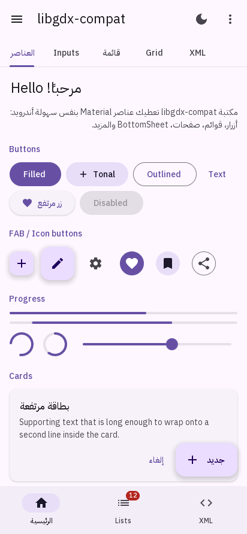
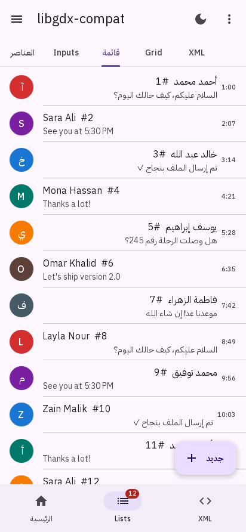
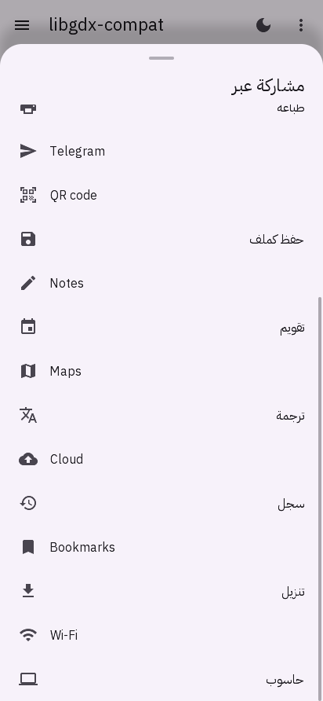
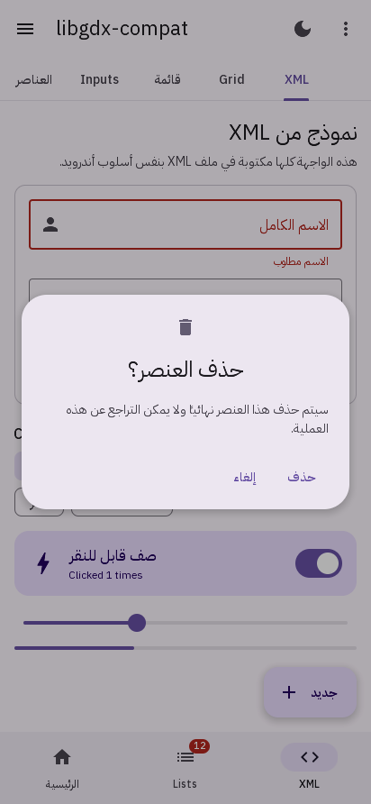
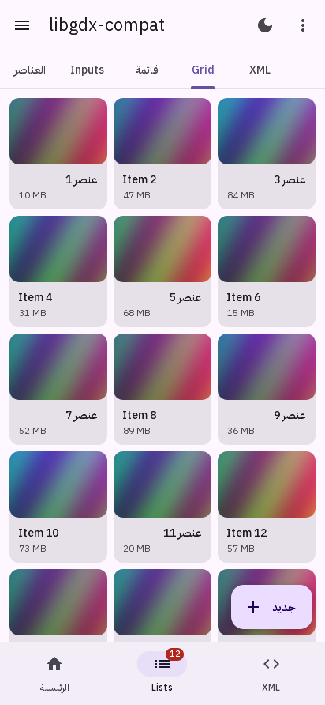
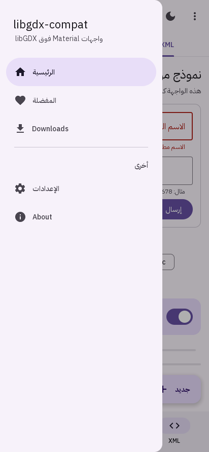
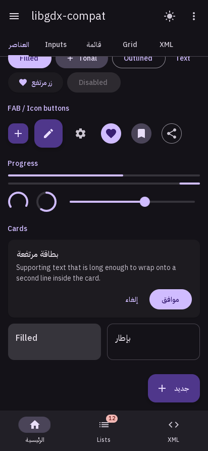
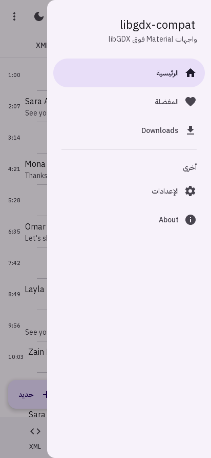

<p align="center">
  
</p>

<h1 align="center">libgdx-compat</h1>

<p align="center">
  AppCompat-style Material 3 UI components for libGDX:<br>
  bottom sheets, FABs, lists, grids, view pagers, dialogs, drawers and Android-style XML layouts.
</p>

<p align="center">
  <a href="https://jitpack.io/#star4droid/libgdx-compat"></a>
  <a href="https://github.com/star4droid/libgdx-compat/releases"></a>
  <a href="https://libgdx.com"></a>
  
  
  
  <a href="https://star4droid.github.io/libgdx-compat/"></a>
  <a href="https://github.com/star4droid/Star2D"></a>
</p>

<p align="center">
  <a href="https://star4droid.github.io/libgdx-compat/"><b>Documentation</b></a> ·
  <a href="https://star4droid.github.io/libgdx-compat/getting-started.html"><b>Getting started</b></a> ·
  <a href="https://github.com/star4droid/libgdx-compat/releases"><b>Download the demo APK</b></a>
</p>

<p align="center">
  
  
  
  
</p>
<p align="center">
  
  
  
  
</p>

## Why this library

libgdx-compat was built for the UI of **[Star2D](https://github.com/star4droid/Star2D)**, my Android 2D game engine. libGDX's Scene2D has no ready-made bottom sheets, floating action buttons, view pagers, recycled lists or grids, so this library brings those components, with the touch behaviour and animations of their Android counterparts, to any libGDX project.

## Features

- Built on Scene2D: every component is a normal `Actor` that drops into any `Stage`.
- One module, plain Java 8: Android, desktop and Linux. Tested with libGDX 1.12.1 and 1.14.2.
- No skin, no images, no custom shader: shapes, shadows and ripples are drawn from code.
- Fast: a typical screen renders in 1–4 draw calls, and lists only create the visible rows.
- Arabic and RTL: letter shaping, bidirectional text and fully mirrored layouts.
- XML layouts with Android's tag and attribute names.

```groovy
repositories { maven { url 'https://jitpack.io' } }
dependencies { api 'com.github.star4droid:libgdx-compat:1.0.0' }
```

```java
Compat.init();
Stage stage = Compat.createStage();

LinearLayout root = LinearLayout.vertical().padding(Compat.dp(16)).spacing(Compat.dp(12));
root.setFillParent(true);
root.add(new TextView("Hello", Typography.HEADLINE_SMALL));
root.add(new Button("Show sheet").onClick(() -> BottomSheet.show(stage, sheetContent)));
stage.addActor(root);
```

Full guide with every component: **https://star4droid.github.io/libgdx-compat/**

## Acknowledgements

Thanks to **Claude Fable 5.2** by [Anthropic](https://www.anthropic.com) for helping me design, build and test this library.

---

## بالعربية

مكتبة واجهات لـ libGDX على نمط AppCompat / Material 3: أزرار، FAB، حقول نص، RecyclerView (قائمة وشبكة)، ViewPager، TabLayout، BottomSheet، Dialog، Snackbar، Drawer، Toolbar، BottomNavigation، Navigator، وتصميم الواجهات عبر XML بنفس أسماء أندرويد.

صُنعت المكتبة لتُستعمل في واجهات محرك الألعاب [Star2D](https://github.com/star4droid/Star2D).

- تعمل فوق Scene2D العادي (`Stage` / `Actor`)، فتدخل في أي مشروع libGDX موجود.
- Java 8 خالصة في موديول واحد: أندرويد، سطح المكتب، لينكس.
- مُجرَّبة مع libGDX ‏1.12.1 و‏1.14.2.
- العربية مدعومة: تشكيل الحروف، الاتجاه RTL، الحركات، وقلب الواجهة كاملة.
- بدون صور ولا Skin ولا شيدر خاص: كل الأشكال تُرسم من الكود.

### التثبيت

**الأسهل:** انسخ `dist/libgdx-compat-1.0.0.jar` إلى مجلد `libs` في موديول core:

```groovy
dependencies {
    api files('libs/libgdx-compat-1.0.0.jar')
    api "com.badlogicgames.gdx:gdx-freetype:$gdxVersion"
}
```

وأضف natives الخاصة بـ FreeType في كل منصة كما في أي مشروع libGDX (`gdx-freetype-platform`). انظر `demo/desktop/build.gradle` و`demo/android/build.gradle` كمثال جاهز.

**أو كموديول:** انسخ مجلد `compat` إلى مشروعك وأضف `include 'compat'` ثم `api project(':compat')`.

**أو JitPack:** بعد عمل Release على GitHub بـ tag باسم `1.0.0`:

```groovy
repositories { maven { url 'https://jitpack.io' } }
dependencies { api 'com.github.star4droid:libgdx-compat:1.0.0' }
```

إذا فعّلت `minifyEnabled` فقواعد R8 اللازمة موجودة داخل الـ jar وتُطبَّق تلقائياً.

### البدء السريع

```java
public class MyGame extends ApplicationAdapter {
    Stage stage;

    public void create () {
        Compat.init();                       // مرة واحدة
        stage = Compat.createStage();        // ScreenViewport + زر الرجوع
        Gdx.input.setInputProcessor(stage);

        LinearLayout root = LinearLayout.vertical().padding(Compat.dp(16)).spacing(Compat.dp(12));
        root.setFillParent(true);
        root.setBackground(Compat.theme.surface);

        root.add(new TextView("مرحباً", Typography.HEADLINE_SMALL));
        root.add(new EditText("الاسم").setLeadingIcon(Icons.PERSON)).matchWidth();
        root.add(new Button("حفظ").icon(Icons.SAVE).onClick(() ->
            Snackbar.make(stage, "تم الحفظ", Snackbar.LENGTH_SHORT).show()));

        stage.addActor(root);
    }

    public void resize (int w, int h) { stage.getViewport().update(w, h, true); }

    public void render () {
        ScreenUtils.clear(Compat.theme.background);
        stage.act();
        stage.draw();
    }

    public void dispose () { stage.dispose(); Compat.dispose(); }
}
```

المقاسات بالبكسل الحقيقي؛ استعمل `Compat.dp(16)` و`Compat.sp(14)` دائماً. إن كنت تستعمل Viewport بمقاس افتراضي ثابت فضع `config.density = عرض_الـstage / 360f`.

### التخطيط

| الصنف | الوصف |
|---|---|
| `LinearLayout` | صف أو عمود، مع `weight` و`gravity` و`spacing` |
| `FrameLayout` | عناصر فوق بعض، كل عنصر يُثبَّت بـ `gravity` |
| `FlowLayout` | صف يلتف لسطر جديد (مجموعات Chip) |
| `ScrollView` | تمرير عمودي أو أفقي لعنصر واحد |
| `CardView` | بطاقة: `ELEVATED` / `FILLED` / `OUTLINED` |

`add()` تُرجع `LayoutParams` للتسلسل:

```java
row.add(title).weight(1).width(0).margins(dp(16), 0, dp(8), 0);
frame.add(fab).gravity(Gravity.BOTTOM | Gravity.END).margin(dp(16));
box.add(child).matchWidth().height(dp(56));
```

كل `ViewGroup` له: `setPadding`، `setBackground`، `setCornerRadius`، `setStroke`، `setElevation`، `setOnClick` (مع Ripple).

### العناصر

`TextView`، `Button` (‏FILLED / TONAL / OUTLINED / TEXT / ELEVATED)، `IconButton`، `Fab` (صغير / عادي / كبير / ممتد مع `extend()` و`shrink()` و`show()` و`hide()`)، `EditText` (‏OUTLINED / FILLED، عنوان عائم، أيقونات، خطأ، كلمة مرور، تحديد ونسخ ولصق)، `CheckBox`، `RadioButton` + `RadioGroup`، `Switch`، `Slider`، `Chip`، `ProgressBar` (خطي ودائري)، `ImageView` (مع زوايا دائرية و`CENTER_CROP`)، `IconView`، `Divider`، `Space`.

الأيقونات: خط Material Icons مضمَّن (~2200 أيقونة). الشائع منها ثوابت في `Icons` والباقي بالاسم: `Icons.get("shopping_cart")`.

### القوائم والشبكات

```java
RecyclerView list = new RecyclerView();
list.setOnItemClick(position -> open(position));          // قبل setAdapter
list.setAdapter(new RecyclerView.ListAdapter<>(items,
    () -> new ContactRow(),                                // يُنشأ عدد قليل فقط
    (row, item, position) -> row.bind(item)));             // يُعاد ربطه عند التمرير

list.setSpanCount(3);            // شبكة
list.setSpacing(dp(8));
list.setDividers(true, dp(72));
list.setOnRefresh(() -> load()); // سحب للتحديث، ثم setRefreshing(false)
list.setOnEndReached(() -> loadMore());
```

للتحكم الكامل (أنواع صفوف متعددة، ارتفاعات مختلفة) ورِّث `RecyclerView.Adapter` كما في أندرويد: `getItemCount`، `getItemViewType`، `onCreateViewHolder`، `onBindViewHolder`، واختيارياً `getItemSize`.

### الصفحات والتبويبات

```java
ViewPager pager = new ViewPager();
pager.addPage(homePage);
pager.addPage(index -> buildHeavyPage());   // تُبنى عند أول اقتراب منها
TabLayout tabs = new TabLayout(TabLayout.MODE_SCROLLABLE);
tabs.addTab("الرئيسية");
tabs.addTab("Settings", Icons.SETTINGS);
tabs.setupWithViewPager(pager);
```

### الطبقات العلوية

```java
BottomSheet sheet = new BottomSheet(content);     // يُسحب بالإصبع: مخفي / نصف / كامل
sheet.setPeekHeight(dp(300)).setFullHeight(true);
sheet.show(stage);

new AlertDialog().setTitle("حذف؟").setMessage("لا يمكن التراجع")
    .setPositiveButton("حذف", () -> delete()).setNegativeButton("إلغاء", null).show(stage);

new PopupMenu().add("تعديل", Icons.EDIT, () -> edit()).add("حذف", Icons.DELETE, () -> delete()).show(anchorView);

Snackbar.make(stage, "تم", Snackbar.LENGTH_LONG).setAction("تراجع", () -> undo()).show();

DrawerLayout drawer = new DrawerLayout();
drawer.setContent(screen);
drawer.setDrawer(new NavigationView().addItem(Icons.HOME, "الرئيسية", () -> go()));
```

`BottomSheet.setModal(false)` يعطيك لوحة سفلية دائمة لا تحجب الشاشة. القائمة داخل الـ sheet تتمرر طبيعياً وتسلّم السحب للـ sheet عند وصولها لأعلاها.

`Toolbar` و`BottomNavigationView` (مع شارات `setBadge`) و`Navigator` لمكدّس الشاشات:

```java
Navigator nav = new Navigator();
nav.setFillParent(true);
stage.addActor(nav);
nav.push(new HomeScreen());     // class HomeScreen extends Navigator.Screen { Actor onCreateView() {...} }
```

زر الرجوع (BACK في أندرويد، ESC في الحاسوب) يغلق أعلى طبقة مفتوحة ثم يرجع شاشة ثم يخرج من التطبيق.

### الواجهات عبر XML

نفس وسوم وخصائص أندرويد، والبادئات `android:` و`app:` اختيارية:

```xml
<LinearLayout android:layout_width="match_parent" android:layout_height="match_parent"
    android:orientation="vertical" android:padding="16dp">
    <TextView android:text="@string/title" android:textAppearance="headlineSmall" />
    <EditText android:id="@+id/name" android:layout_width="match_parent" android:hint="الاسم" app:startIcon="person" />
    <Button android:text="إرسال" android:onClick="onSend" app:icon="send" android:layout_gravity="end" />
</LinearLayout>
```

```java
Actor root = new LayoutInflater().putString("title", "تسجيل")
    .inflate(Gdx.files.internal("layouts/login.xml"), this);   // this = صاحب دوال onClick
EditText name = Views.find(root, "name");

public void onSend () { ... }          // أو onSend(Actor view)
```

**الوسوم:** LinearLayout، FrameLayout، FlowLayout / ChipGroup، ScrollView، HorizontalScrollView، CardView، TextView، Button، ImageButton، FloatingActionButton، EditText / TextInputLayout، CheckBox، RadioButton، RadioGroup، Switch، Slider / SeekBar، Chip، ProgressBar، ImageView، Icon، Divider، Space، RecyclerView، ViewPager، TabLayout (أبناؤه `<TabItem text icon/>`)، Toolbar (أبناؤه `<item icon onClick/>`)، BottomNavigationView و NavigationView (أبناؤهما `<item icon title/>`)، DrawerLayout، `<include layout="other.xml"/>`. الأسماء الكاملة مثل `com.google.android.material.card.MaterialCardView` مقبولة أيضاً.

**الخصائص العامة:** `id`، `layout_width` / `layout_height` (‏`match_parent`، `wrap_content`، `16dp`)، `layout_weight`، `layout_gravity`، `layout_margin*`، `padding*`، `background`، `visibility`، `enabled`، `alpha`، `onClick`، ومن عندنا: `cornerRadius`، `elevation`، `strokeColor`، `strokeWidth`، `spacing`.

**القيم:** مقاسات `dp` / `sp` / `px` / `@dimen/x`، ألوان `#RRGGBB` / `#AARRGGBB` / `@color/primary` / `?attr/colorOnSurface`، نصوص `@string/x`، أيقونات بالاسم (`add` أو `@drawable/ic_add`).

**وسم خاص بك:** `LayoutInflater.register("MyView", (attrs, inflater) -> new MyView(attrs.string("title")));`

### الثيم

`Compat.theme` كائن واحد بألوان Material 3. تغييره يُعيد تلوين كل الواجهة فوراً دون إعادة بنائها:

```java
Compat.theme.set(Theme.dark());
Compat.theme.set(Theme.fromSeed(Color.valueOf("00897B"), false));   // مخطط كامل من لون واحد
Compat.theme.primary.set(Color.RED);                                // أو لون بعينه
```

أحجام النصوص في `Typography.SIZE`، ونصف أقطار الزوايا في `theme.cornerMedium` وأخواتها. الخطوط تُستبدل عبر `Compat.Config` (‏`regularFont`، `mediumFont`).

### العربية و RTL

- النص العربي يُشكَّل ويُرتَّب تلقائياً في كل عنصر، مع خلط الإنجليزية والأرقام.
- `config.rtl = true` (أو `Compat.setRtl(true)` قبل بناء الواجهة) يقلب كل شيء: ترتيب الصفوف، الهوامش، الدرج، التبويبات، اتجاه السحب.
- أي خط بديل للعربية يجب أن يحتوي جدول Presentation Forms (‏U+FE70–U+FEFF)، مثل الخط المضمَّن IBM Plex Sans Arabic.

### الأداء

ما فعلته المكتبة:

- **أطلس واحد** للأشكال والنصوص والأيقونات، فالشاشة كلها تُرسم في 1–4 draw calls.
- العناصر البسيطة ترسم نفسها مباشرة دون Actors داخلية، والحاويات بلا مصفوفة تحويل.
- `RecyclerView` ينشئ الصفوف الظاهرة فقط ويعيد استعمالها؛ تغيّر صف لا يعيد تخطيط الشاشة.
- النص يُقاس ويُشكَّل مرة واحدة ثم يُرسم من cache.
- الحروف تُولَّد عند الحاجة فقط (لا قائمة حروف مسبقة).
- المكتبة تطلب الإطارات وقت الحركة فقط، فيمكنك `Gdx.graphics.setContinuousRendering(false)` لتوفير البطارية.

قياسات تطبيق المعرض (سطح المكتب، 412×892 و1080×2340):

| الحالة | draw calls | تخصيص ذاكرة لكل إطار |
|---|---|---|
| شاشة ثابتة | 3 | ~60 بايت |
| قذف قائمة 100,000 صف | 3 | ~0.6 ك.ب (نصوص الصفوف الجديدة) |
| قذف شبكة 3 أعمدة بصور | 4–5 | ~0.5–1 ك.ب |
| 3 ثوانٍ خمول مع إيقاف الرسم المستمر | 0 إطار | — |

نصائح:

- صور صغيرة متكررة (أفاتار، أيقونات خاصة): `Compat.gfx().pack(pixmap)` يضعها في الأطلس نفسه فلا تزيد draw calls.
- كل حاوية بتمرير أو `setClip(true)` تكلف draw call إضافية أو اثنتين.
- صفحة الأطلس 1024×1024 (4 م.ب)، وتُضاف صفحة تلقائياً عند الامتلاء.

### قيود معروفة

- `EditText` سطر واحد فقط. والمؤشر داخل نص يخلط عربي وإنجليزي تقريبي الموضع.
- الحركات (التشكيل) تُوضَع فوق الحرف بتوسيط تقريبي، لأن libGDX لا يقرأ جداول GPOS للخط.
- لا يوجد دعم للغات تحتاج تشكيلاً معقداً غير العربية، ولا للإيموجي الملوّنة.
- عند ظهور لوحة المفاتيح في أندرويد استعمل `android:windowSoftInputMode="adjustResize"` (كما في المعرض) أو أبلغ المكتبة بارتفاعها عبر `Compat.setKeyboardHeight(px)`.
- إضافة / حذف عناصر `RecyclerView` بلا حركة انتقالية.
- GWT / HTML غير مدعوم (بسبب FreeType).

### تشغيل المعرض والاختبارات

```bash
./gradlew :demo:desktop:run                    # المعرض على الحاسوب (أضف --args="--rtl" للعربية)
./gradlew :demo:android:assembleDebug          # APK (يحتاج Android SDK في local.properties)
./gradlew :demo:desktop:writeCp && ./run-test.sh tour   # اختبار آلي: لمسات مبرمجة + لقطات في shots/
```

اختبارات `run-test.sh`: ‏`tour` (كل المكونات)، `inputs`، `rtl --rtl`، `idle`. تحتاج `xvfb` على لينكس.

### التوثيق

موقع التوثيق الإنجليزي في مجلد `docs/` (يُولَّد من `docs-src/` عبر `python3 docs-src/build.py`) ومنشور على GitHub Pages.

### التراخيص

- IBM Plex Sans Arabic — SIL Open Font License 1.1
- Material Icons — Apache License 2.0

التفاصيل في `THIRD_PARTY.md`.
