<p align="center">
  
</p>

<h1 align="center">libgdx-compat</h1>

<p align="center">
  AppCompat-style Material 3 UI components for libGDX:<br>
  bottom sheets, FABs, lists, grids, view pagers, dialogs, drawers and Android-style XML layouts.
</p>

<p align="center">
  <a href="https://jitpack.io/#star4droid/libgdx-compat"></a>
  <a href="https://github.com/star4droid/libgdx-compat/releases"></a>
  <a href="https://libgdx.com"></a>
  
  
  
  <a href="https://star4droid.github.io/libgdx-compat/"></a>
  <a href="https://github.com/star4droid/Star2D"></a>
</p>

<p align="center">
  <a href="https://star4droid.github.io/libgdx-compat/"><b>Documentation</b></a> ·
  <a href="https://star4droid.github.io/libgdx-compat/getting-started.html"><b>Getting started</b></a> ·
  <a href="https://github.com/star4droid/libgdx-compat/releases"><b>Demo APK</b></a> ·
  <a href="README.ar.md"><b>Arabic</b></a>
</p>

<table>
<tr><td>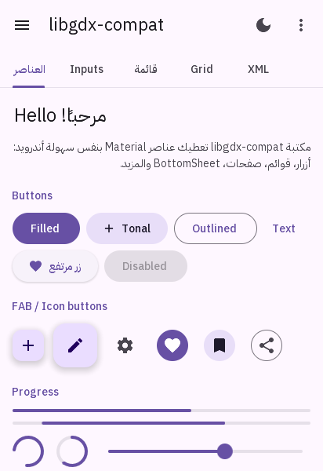</td><td>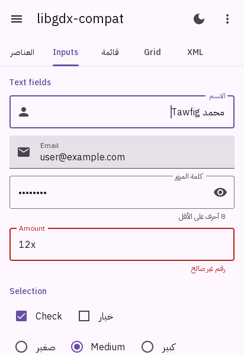</td><td>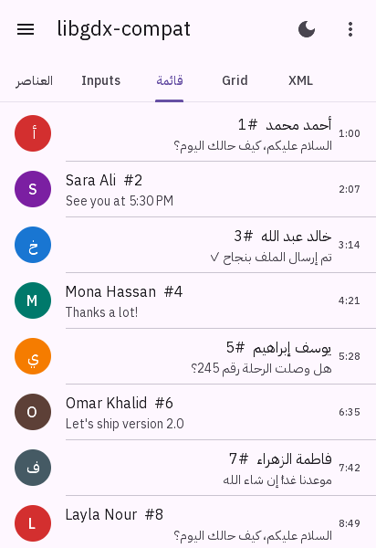</td><td>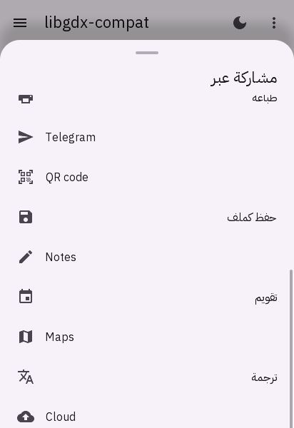</td><td>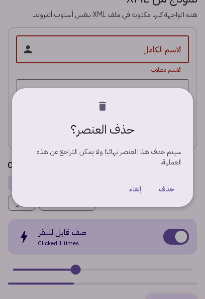</td><td>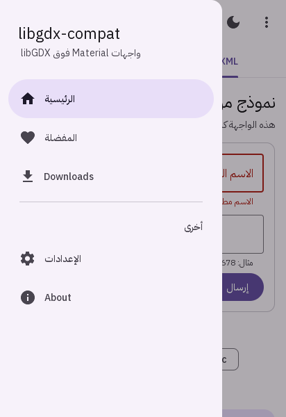</td><td>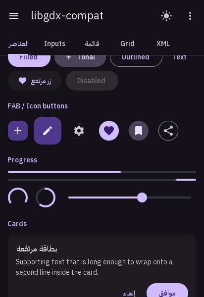</td><td>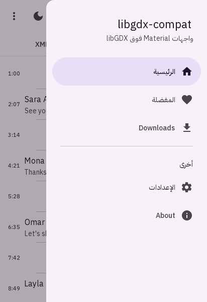</td></tr>
<tr><td align="center"><sub>Widgets</sub></td><td align="center"><sub>Text fields</sub></td><td align="center"><sub>RecyclerView</sub></td><td align="center"><sub>Bottom sheet</sub></td><td align="center"><sub>Dialog</sub></td><td align="center"><sub>Drawer</sub></td><td align="center"><sub>Dark theme</sub></td><td align="center"><sub>Right-to-left</sub></td></tr>
</table>

## Why this library

libgdx-compat was built for the UI of **[Star2D](https://github.com/star4droid/Star2D)**, my Android 2D game engine. libGDX's Scene2D has no ready-made bottom sheets, floating action buttons, view pagers, recycled lists or grids, so this library brings those components, with the touch behaviour and animations of their Android counterparts, to any libGDX project.

## Features

- **Built on Scene2D.** Every component is a normal `Actor` that drops into any `Stage`.
- **One module, plain Java 8.** Android, desktop and Linux. Tested with libGDX 1.12.1 and 1.14.2.
- **No skin, no images, no custom shader.** Shapes, shadows and ripples are drawn from code.
- **Fast.** A typical screen renders in 1–4 draw calls; lists only create the rows that are visible.
- **Arabic and RTL.** Letter shaping, bidirectional text and fully mirrored layouts.
- **XML layouts** with Android's tag and attribute names.

## Installation

```groovy
// root build.gradle (or settings.gradle)
repositories { maven { url 'https://jitpack.io' } }

// core/build.gradle
dependencies {
    api 'com.github.star4droid:libgdx-compat:1.0.0'
    api "com.badlogicgames.gdx:gdx-freetype:$gdxVersion"
}
```

Each platform also needs the FreeType natives (`gdx-freetype-platform`), as in any libGDX project that uses fonts. The jar is also available on the [releases page](https://github.com/star4droid/libgdx-compat/releases). Details: [Getting started](https://star4droid.github.io/libgdx-compat/getting-started.html).

## Quick start

```java
public class MyGame extends ApplicationAdapter {
    Stage stage;

    @Override public void create () {
        Compat.init();                       // once
        stage = Compat.createStage();        // ScreenViewport + back-key handling
        Gdx.input.setInputProcessor(stage);

        LinearLayout root = LinearLayout.vertical().padding(Compat.dp(16)).spacing(Compat.dp(12));
        root.setFillParent(true);
        root.setBackground(Compat.theme.surface);

        root.add(new TextView("Hello", Typography.HEADLINE_SMALL));
        root.add(new EditText("Name").setLeadingIcon(Icons.PERSON)).matchWidth();
        root.add(new Button("Save").icon(Icons.SAVE).onClick(() ->
                Snackbar.make(stage, "Saved", Snackbar.LENGTH_SHORT).show()));

        stage.addActor(root);
    }

    @Override public void resize (int w, int h) { stage.getViewport().update(w, h, true); }

    @Override public void render () {
        ScreenUtils.clear(Compat.theme.background);
        stage.act();
        stage.draw();
    }

    @Override public void dispose () { stage.dispose(); Compat.dispose(); }
}
```

Sizes are real pixels: use `Compat.dp(16)` and `Compat.sp(14)`.

## Components

| Area | Components |
|---|---|
| [Layouts](https://star4droid.github.io/libgdx-compat/layouts.html) | `LinearLayout`, `FrameLayout`, `FlowLayout`, `ScrollView`, `CardView` |
| [Widgets](https://star4droid.github.io/libgdx-compat/widgets.html) | `TextView`, `Button`, `IconButton`, `Fab`, `EditText`, `CheckBox`, `RadioButton`, `Switch`, `Slider`, `Chip`, `ProgressBar`, `ImageView`, `IconView` |
| [Lists & pages](https://star4droid.github.io/libgdx-compat/lists.html) | `RecyclerView` (list and grid), pull-to-refresh, `ViewPager`, `TabLayout` |
| [Overlays](https://star4droid.github.io/libgdx-compat/overlays.html) | `BottomSheet`, `AlertDialog`, `PopupMenu`, `Snackbar` |
| [Navigation](https://star4droid.github.io/libgdx-compat/navigation.html) | `Toolbar`, `BottomNavigationView`, `DrawerLayout`, `NavigationView`, `Navigator` |
| [XML layouts](https://star4droid.github.io/libgdx-compat/xml.html) | `LayoutInflater` with Android tag names, `onClick`, `@string`, `@color`, `<include>` |
| [Theming](https://star4droid.github.io/libgdx-compat/theming.html) | Material 3 colour roles, seed colours, dark mode, type scale, Arabic / RTL |

### Lists, grids and pages

Only the visible rows exist; they are recycled while scrolling, so 100 000 items cost the same as 10.

```java
RecyclerView list = new RecyclerView();
list.setOnItemClick(position -> open(position));
list.setAdapter(new RecyclerView.ListAdapter<>(contacts,
        () -> new ContactRow(),                          // creates a row
        (row, contact, position) -> row.bind(contact))); // fills it while scrolling

list.setSpanCount(3);                                    // grid
list.setOnRefresh(() -> reload());                       // pull to refresh

TabLayout tabs = new TabLayout(TabLayout.MODE_SCROLLABLE);
tabs.addTab("Home");
tabs.addTab("Settings", Icons.SETTINGS);
tabs.setupWithViewPager(pager);
```

<table>
<tr><td></td><td>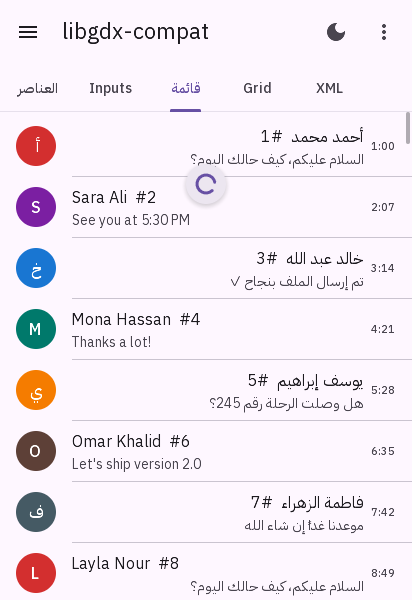</td><td>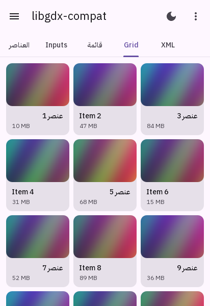</td><td>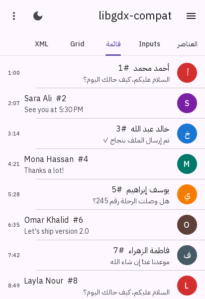</td></tr>
<tr><td align="center"><sub>List with dividers</sub></td><td align="center"><sub>Pull to refresh</sub></td><td align="center"><sub>Grid + scrollable tabs</sub></td><td align="center"><sub>List in RTL mode</sub></td></tr>
</table>

### Bottom sheets, dialogs and menus

```java
new BottomSheet(content).setFullHeight(true).show(stage);   // drag between hidden / half / full

new AlertDialog().setTitle("Delete item?").setMessage("This cannot be undone.")
        .setNegativeButton("Cancel", null)
        .setPositiveButton("Delete", () -> delete())
        .show(stage);

new PopupMenu().add("Edit", Icons.EDIT, () -> edit()).add("Delete", Icons.DELETE, () -> delete()).show(anchor);

Snackbar.make(stage, "Archived", Snackbar.LENGTH_LONG).setAction("Undo", () -> undo()).show();
```

A list inside a bottom sheet scrolls normally and hands the drag over to the sheet when it reaches its top.

<table>
<tr><td>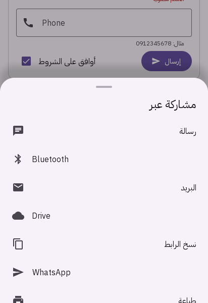</td><td></td><td></td><td>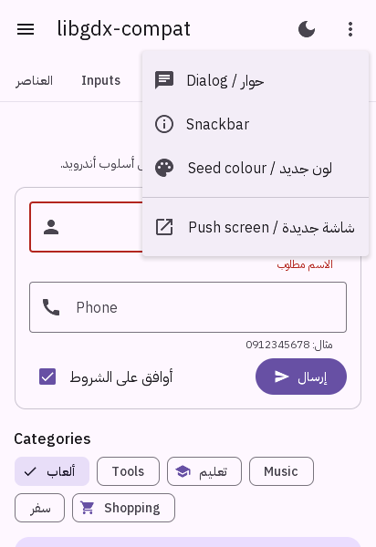</td><td>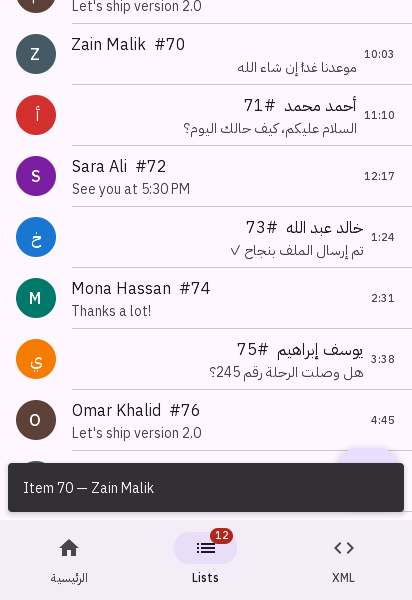</td></tr>
<tr><td align="center"><sub>Bottom sheet (collapsed)</sub></td><td align="center"><sub>Bottom sheet (expanded)</sub></td><td align="center"><sub>AlertDialog</sub></td><td align="center"><sub>PopupMenu</sub></td><td align="center"><sub>Snackbar</sub></td></tr>
</table>

### Navigation

```java
DrawerLayout drawer = new DrawerLayout();
drawer.setContent(mainScreen);
drawer.setDrawer(new NavigationView()
        .addItem(Icons.HOME, "Home", () -> showHome())
        .addItem(Icons.SETTINGS, "Settings", () -> showSettings()));

Navigator navigator = new Navigator();            // back stack with slide transitions
navigator.push(new HomeScreen());                 // the back key pops it
```

`Toolbar` and `BottomNavigationView` (with badges) complete the set. Android BACK / desktop ESC closes the top-most dialog, sheet or drawer, then pops a screen.

<table>
<tr><td></td><td>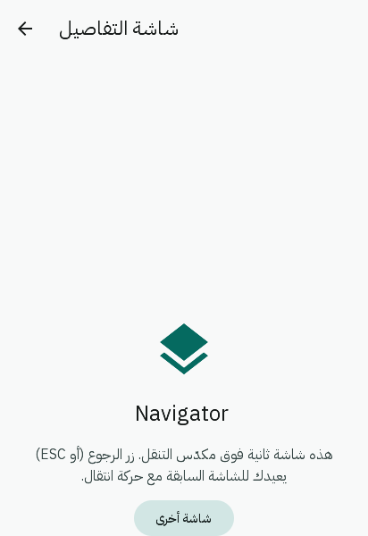</td><td></td></tr>
<tr><td align="center"><sub>Navigation drawer</sub></td><td align="center"><sub>Navigator screen</sub></td><td align="center"><sub>Toolbar, tabs, bottom bar</sub></td></tr>
</table>

### XML layouts

The same tags and attributes as Android; the `android:` and `app:` prefixes are optional.

```xml
<LinearLayout android:layout_width="match_parent" android:layout_height="match_parent"
    android:orientation="vertical" android:padding="16dp">
    <TextView android:text="@string/title" android:textAppearance="headlineSmall" />
    <EditText android:id="@+id/name" android:layout_width="match_parent" android:hint="Name" app:startIcon="person" />
    <Button android:text="Send" android:onClick="onSend" app:icon="send" android:layout_gravity="end" />
</LinearLayout>
```

```java
Actor root = new LayoutInflater().putString("title", "Sign in")
        .inflate(Gdx.files.internal("layouts/login.xml"), this);   // this = owner of onSend()
EditText name = Views.find(root, "name");
```

<table>
<tr><td>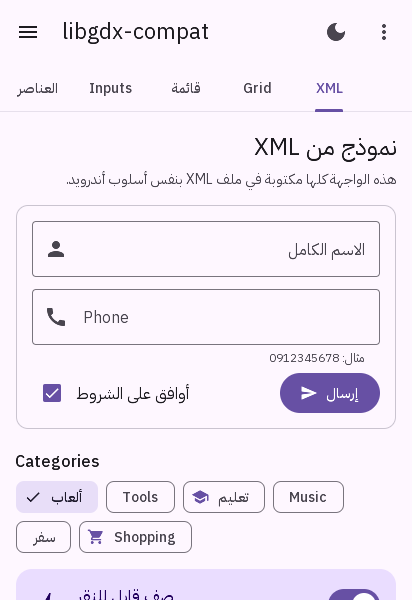</td></tr>
<tr><td align="center"><sub>Screen inflated from XML</sub></td></tr>
</table>

### Theming and RTL

```java
Compat.theme.set(Theme.dark());
Compat.theme.set(Theme.fromSeed(Color.valueOf("00897B"), false));  // full scheme from one colour

Compat.Config config = new Compat.Config();
config.rtl = true;                                                 // mirror the whole UI
Compat.init(config);
```

Changing the theme restyles every widget immediately, with no rebuild. Arabic text is shaped and reordered automatically in every component.

<table>
<tr><td></td><td>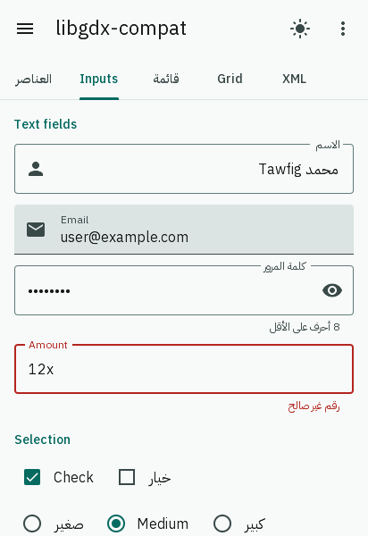</td><td></td><td></td></tr>
<tr><td align="center"><sub>Dark theme</sub></td><td align="center"><sub>Seed colour theme</sub></td><td align="center"><sub>RTL drawer</sub></td><td align="center"><sub>RTL list</sub></td></tr>
</table>

## Performance

| Scenario (gallery app, desktop) | Draw calls | Allocation per frame |
|---|---|---|
| Static screen | 3 | about 60 bytes |
| Fling through a 100 000-row list | 3 | about 0.6 KB |
| Fling through a 3-column image grid | 4–5 | about 0.5–1 KB |
| 3 s idle with continuous rendering off | 0 frames | – |

Shapes, text and icons share one atlas page, widgets draw themselves without inner actors, and components only request frames while they animate. More in [Performance](https://star4droid.github.io/libgdx-compat/performance.html).

## Demo app

Download `libgdx-compat-demo.apk` from the [releases page](https://github.com/star4droid/libgdx-compat/releases), or run it from source:

```bash
./gradlew :demo:desktop:run                  # desktop gallery (--args="--rtl" for right-to-left)
./gradlew :demo:android:assembleDebug        # Android APK (needs sdk.dir in local.properties)
```

Scripted UI tests that tap, drag and type through the gallery are described in [Demo & testing](https://star4droid.github.io/libgdx-compat/demo.html).

## Documentation

The full guide, with every component and option, is at **https://star4droid.github.io/libgdx-compat/**. Its source is in `docs-src/` (Markdown); `python3 docs-src/build.py` regenerates the site in `docs/`.

## Acknowledgements

Thanks to **Claude Fable 5.2** by [Anthropic](https://www.anthropic.com) for helping me design, build and test this library.

## Third-party assets

IBM Plex Sans Arabic (SIL Open Font License 1.1) and Material Icons (Apache License 2.0). See [THIRD_PARTY.md](THIRD_PARTY.md).
